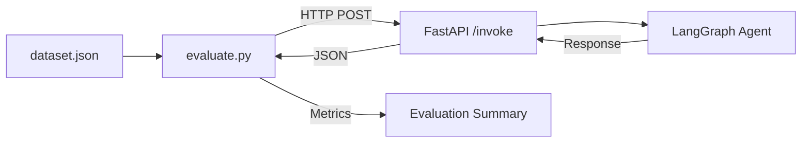

# AI Agent Evaluation Framework

An automated evaluation pipeline for testing LangGraph-based AI Agents. This framework measures **Tool Accuracy**, **Answer Quality**, and **Latency** using a Golden Dataset.

## Features

- 📊 **Tool Accuracy** - Measures if the Agent calls the correct tool
- 💬 **Answer Quality** - Checks if the final answer contains expected keywords
- ⏱️ **Latency** - Measures response time
- 📁 **Golden Dataset** - JSON-based test cases
- 🔄 **Regression Testing** - Run after every prompt/model change

## Architecture



## Tech Stack

- **Python** - Evaluation script
- **FastAPI** - Agent API wrapper
- **LangGraph** - Multi-Agent system
- **Ollama** - Local LLM (llama3.2)

## Installation

```bash
# Install dependencies
uv add requests fastapi uvicorn

# Start the Agent API (Terminal 1)
cd ../agent
uv run uvicorn main:app --reload --port 8000

# Run Evaluation (Terminal 2)
cd ../agent-evaluator
python evaluate.py
```

## Dataset Format

Each test case in `dataset.json` contains:

```json
{
  "id": "test_001",
  "query": "What is the weather in Auckland today?",
  "expected_tool": "get_weather",
  "expected_keywords": ["Auckland", "temperature", "°C"]
}
```

## Metrics

| Metric | Description |
| :--- | :--- |
| **Tool Accuracy** | % of test cases where the correct tool was called |
| **Answer Accuracy** | % of test cases where all expected keywords were found |
| **Avg Latency** | Average response time (seconds) |

## Sample Output

```
========================================
📊 Evaluation Summary
========================================
Total Tests: 3
🔧 Tool Accuracy:    66.7%  (2/3)
💬 Answer Accuracy:  66.7%  (2/3)
⏱️ Avg Latency:     14.54s
========================================
```

## Findings

- ✅ Weather & Word Count queries work correctly
- ❌ World Cup query fails (Agent didn't call Wikipedia tool)
- ⚠️ Latency is high (14s) due to local LLM inference

## Next Steps

- [ ] Improve Agent's System Prompt for factual queries
- [ ] Add more test cases (edge cases)
- [ ] Add LLM-as-a-Judge for semantic evaluation
- [ ] Add Streamlit dashboard for visualization

## Project Structure

```
agent-evaluator/
├── dataset.json       # Golden Dataset
├── evaluate.py        # Evaluation Script
└── README.md
```

## License

MIT